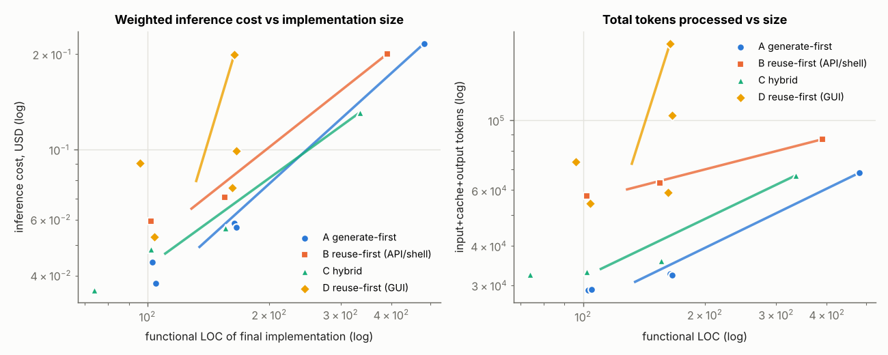
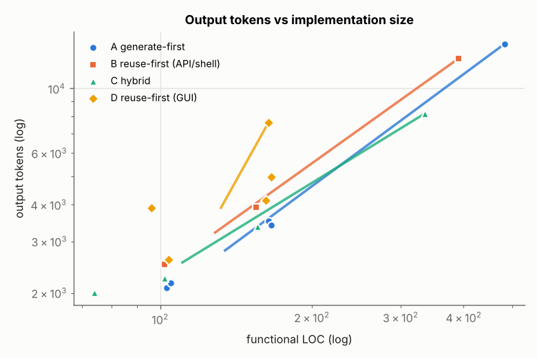
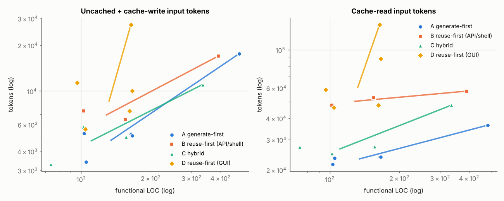
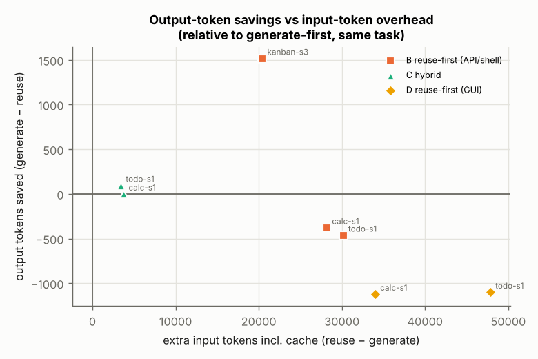
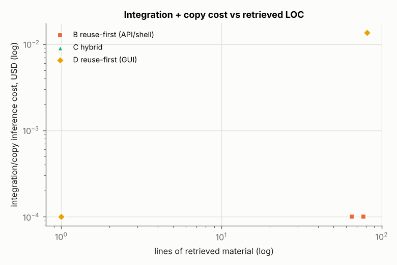
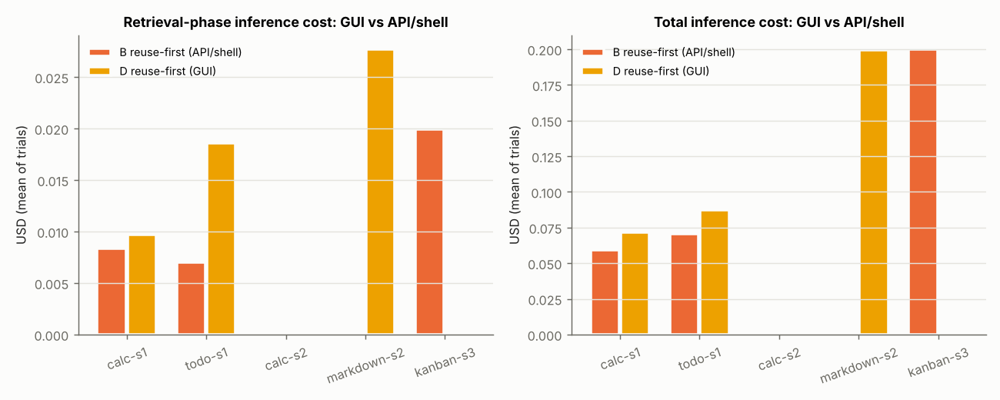
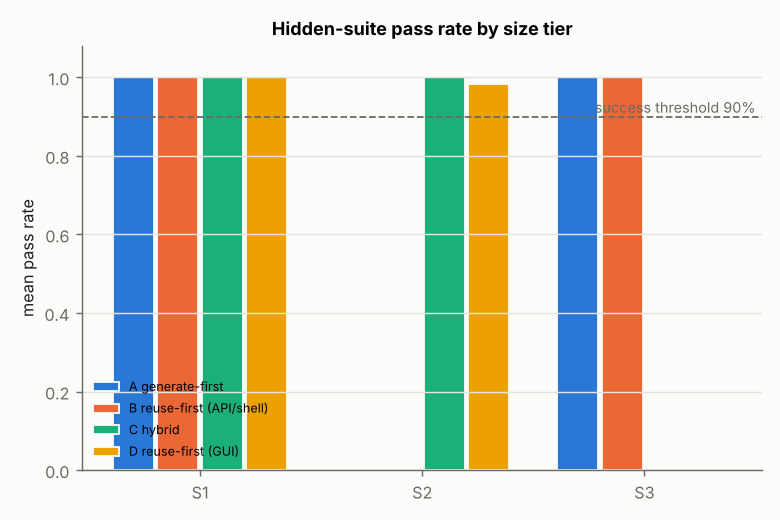

# Size-dependent retrieval economics — pilot report

_Generated by `bench/harness/report.py` from 17 runs. Model `claude-sonnet-5-5` (effort `medium`) for every strategy; agent harness: Claude Code CLI headless (`2.1.316 (Claude Code)`)._

Tasks executed: `calc-s1` (S1), `todo-s1` (S1), `calc-s2` (S2), `markdown-s2` (S2), `kanban-s3` (S3). Total measured inference spend: **$1.53**; agent wall-clock 0.19 h.

## 1. Telemetry validation

- Runs whose per-message transcript usage sums **exactly** to the harness-reported aggregate (all four token classes): **17/17**. Unattributed tokens (harness aggregate minus per-message sum): 0.
- Max |computed cost − harness-reported cost| per run: $0.000001 (pricing from the live Anthropic pricing page; the harness prices at list).
- Every model invocation is one event in `results/events.jsonl` with provider-reported `input_tokens`, `output_tokens`, `cache_read` (as `cached_input_tokens`), `cache_creation` (5m/1h split) and `thinking_tokens` where reported. No token count is estimated; the only estimates are flagged columns (`screenshot_tokens_estimate`, `compute_cost_usd_estimate`, `irrelevant_reading_cost_usd_est`).

## 2. Results by task and strategy

| tier | task | strategy | n | pass rate | success (≥90%) | func. LOC | inference $ mean [95% CI] | tokens (incl. cache) | output tok | elapsed min | external code |
|---|---|---|---|---|---|---|---|---|---|---|---|
| S1 | calc-s1 | A gen | 2 | 100% | 100% | 104 | 0.041 [0.038–0.044] | 29k | 2.1k | 0.4 | 0% |
| S1 | calc-s1 | D GUI | 2 | 100% | 100% | 100 | 0.072 [0.053–0.090] | 64k | 3.2k | 0.6 | 0% |
| S1 | calc-s1 | C hybrid | 2 | 100% | 100% | 88 | 0.042 [0.036–0.048] | 33k | 2.1k | 0.4 | 0% |
| S1 | calc-s1 | B reuse | 1 | 100% | 100% | 102 | 0.059 | 58k | 2.5k | 0.5 | 0% |
| S1 | todo-s1 | A gen | 2 | 100% | 100% | 165 | 0.058 [0.057–0.058] | 32k | 3.5k | 0.4 | 0% |
| S1 | todo-s1 | D GUI | 2 | 100% | 100% | 164 | 0.087 [0.076–0.099] | 81k | 4.6k | 0.7 | 0% |
| S1 | todo-s1 | C hybrid | 1 | 100% | 100% | 156 | 0.056 | 36k | 3.4k | 0.4 | 0% |
| S1 | todo-s1 | B reuse | 1 | 100% | 100% | 155 | 0.071 | 63k | 3.9k | 0.7 | 0% |
| S2 | calc-s2 | C hybrid | 1 | 100% | 100% | 335 | 0.131 | 67k | 8.2k | 1.0 | 0% |
| S2 | markdown-s2 | D GUI | 1 | 98% | 100% | 164 | 0.199 | 175k | 7.6k | 1.3 | 47% |
| S3 | kanban-s3 | A gen | 1 | 100% | 100% | 482 | 0.215 | 68k | 14.1k | 1.4 | 0% |
| S3 | kanban-s3 | B reuse | 1 | 100% | 100% | 391 | 0.200 | 87k | 12.6k | 1.4 | 0% |

_Pass rate = hidden-suite tests passed / tests in suite. External code = share of non-trivial final source lines that match retrieved material (exact or token-skeleton match)._

## 3. Crossover analysis (reuse_cost / generate_cost)

Ratio < 1 ⇒ the reuse strategy is cheaper than generate-first on that task. Quality-adjusted ratios divide each run's cost by its pass rate.

### Raw cost ratios

| tier | task | vs A | total tokens | inference $ | execution $ | wall-clock |
|---|---|---|---|---|---|---|
| S1 | calc-s1 | D GUI | 2.21 | 1.75 | 1.75 | 1.75 |
| S1 | calc-s1 | C hybrid | 1.13 | 1.03 | 1.03 | 1.18 |
| S1 | calc-s1 | B reuse | 1.99 | 1.45 | 1.45 | 1.42 |
| S1 | todo-s1 | D GUI | 2.51 | 1.52 | 1.52 | 1.65 |
| S1 | todo-s1 | C hybrid | 1.10 | **0.98** | **0.98** | **0.90** |
| S1 | todo-s1 | B reuse | 1.94 | 1.23 | 1.23 | 1.52 |
| S3 | kanban-s3 | B reuse | 1.28 | **0.93** | **0.93** | **0.99** |

### Quality-adjusted cost ratios

| tier | task | vs A | total tokens | inference $ | execution $ | wall-clock |
|---|---|---|---|---|---|---|
| S1 | calc-s1 | D GUI | 2.21 | 1.75 | 1.75 | 1.75 |
| S1 | calc-s1 | C hybrid | 1.13 | 1.03 | 1.03 | 1.18 |
| S1 | calc-s1 | B reuse | 1.99 | 1.45 | 1.45 | 1.42 |
| S1 | todo-s1 | D GUI | 2.51 | 1.52 | 1.52 | 1.65 |
| S1 | todo-s1 | C hybrid | 1.10 | **0.98** | **0.98** | **0.90** |
| S1 | todo-s1 | B reuse | 1.94 | 1.23 | 1.23 | 1.52 |
| S3 | kanban-s3 | B reuse | 1.28 | **0.93** | **0.93** | **0.99** |

### Geometric-mean ratio per tier (raw)

| strategy | metric | S1 | S3 |
|---|---|---|---|
| D GUI | execution_usd | 1.63 | – |
| D GUI | inference_usd | 1.63 | – |
| D GUI | tokens | 2.36 | – |
| D GUI | tokens_uncached | 1.42 | – |
| D GUI | wall_clock_s | 1.70 | – |
| C hybrid | execution_usd | 1.01 | – |
| C hybrid | inference_usd | 1.01 | – |
| C hybrid | tokens | 1.12 | – |
| C hybrid | tokens_uncached | **0.99** | – |
| C hybrid | wall_clock_s | 1.03 | – |
| B reuse | execution_usd | 1.34 | **0.93** |
| B reuse | inference_usd | 1.33 | **0.93** |
| B reuse | tokens | 1.96 | 1.28 |
| B reuse | tokens_uncached | 1.16 | **0.89** |
| B reuse | wall_clock_s | 1.47 | **0.99** |

### Log-log fit of ratio vs functional LOC (pooled across families)

`log10(ratio) = a + b·log10(LOC)`; crossover = LOC where the fitted ratio is 1. With 3 tiers and ≤3 trials this is indicative only.

| strategy | metric | n_points | slope | crossover | interpretation |
|---|---|---|---|---|---|
| D GUI | execution_usd | 2.0 | -0.31 | 623 LOC (extrapolated) | reuse gets relatively cheaper as size grows |
| D GUI | inference_usd | 2.0 | -0.32 | 616 LOC (extrapolated) | reuse gets relatively cheaper as size grows |
| D GUI | tokens | 2.0 | +0.27 | 6 LOC (extrapolated) | reuse gets relatively more expensive as size grows |
| D GUI | tokens_uncached | 2.0 | -0.32 | 394 LOC (extrapolated) | reuse gets relatively cheaper as size grows |
| D GUI | wall_clock_s | 2.0 | -0.13 | 8,471 LOC (extrapolated) | reuse gets relatively cheaper as size grows |
| C hybrid | execution_usd | 2.0 | -0.11 | 138 LOC | reuse gets relatively cheaper as size grows |
| C hybrid | inference_usd | 2.0 | -0.11 | 138 LOC | reuse gets relatively cheaper as size grows |
| C hybrid | tokens | 2.0 | -0.05 | 1,049 LOC (extrapolated) | reuse gets relatively cheaper as size grows |
| C hybrid | tokens_uncached | 2.0 | -0.06 | 106 LOC | reuse gets relatively cheaper as size grows |
| C hybrid | wall_clock_s | 2.0 | -0.57 | 138 LOC | reuse gets relatively cheaper as size grows |
| B reuse | execution_usd | 3.0 | -0.29 | 364 LOC | reuse gets relatively cheaper as size grows |
| B reuse | inference_usd | 3.0 | -0.29 | 362 LOC | reuse gets relatively cheaper as size grows |
| B reuse | tokens | 3.0 | -0.31 | 1,150 LOC (extrapolated) | reuse gets relatively cheaper as size grows |
| B reuse | tokens_uncached | 3.0 | -0.19 | 277 LOC | reuse gets relatively cheaper as size grows |
| B reuse | wall_clock_s | 3.0 | -0.26 | 535 LOC (extrapolated) | reuse gets relatively cheaper as size grows |

## 4. Where the money goes (cost share by action, emitted-action attribution)

| strategy | tier | planning | web_search | github_search | file_copy | computer_use | screenshot | code_generation | test_execution | other |
|---|---|---|---|---|---|---|---|---|---|---|
| A gen | S1 | 13% |  |  |  |  |  | 59% |  | 29% |
| A gen | S3 | 2% |  |  |  |  |  | 64% |  | 34% |
| D GUI | S1 | 9% |  |  |  | 11% | 7% | 49% |  | 24% |
| D GUI | S2 | 2% |  |  | 7% | 4% | 3% | 68% | 11% | 6% |
| C hybrid | S1 | 16% |  |  |  |  |  | 56% |  | 28% |
| C hybrid | S2 | 3% |  |  |  |  |  | 66% |  | 31% |
| B reuse | S1 | 15% | 2% | 10% |  |  |  | 44% |  | 29% |
| B reuse | S3 | 2% |  | 10% |  |  |  | 61% |  | 27% |

_Each invocation is attributed to the tool call it emitted. `results/cost_by_action.csv` also has the consumed-result attribution (cost assigned to the tool output the call was reading)._

## 5. Retrieval efficiency

| strategy | tier | n | queries | results seen | repos inspected | clones | files inspected | snippets | retrieved LOC | incorporated | modified | generated LOC | external % | search→use | retrieval fail % | retrieval cost share | irrelevant reading $ (est.) | integration $ | acquisition time |
|---|---|---|---|---|---|---|---|---|---|---|---|---|---|---|---|---|---|---|---|
| D GUI | S1 | 4 | 1.2 | 0.0 | 0.0 | 0.0 | 0.0 | 0.0 | 0 | 0 | 0 | 132 | 0% | – | 0% | 18% | $0.000 | $0.000 | 0.0s |
| D GUI | S2 | 1 | 1.0 | 0.0 | 0.0 | 0.0 | 0.0 | 1.0 | 81 | 77 | 0 | 87 | 47% | 100% | 0% | 14% | $0.005 | $0.014 | 0.0s |
| C hybrid | S1 | 3 | 0.0 | 0.0 | 0.0 | 0.0 | 0.0 | 0.0 | 0 | 0 | 0 | 111 | 0% | – | 0% | 0% | $0.000 | $0.000 | 0.0s |
| C hybrid | S2 | 1 | 0.0 | 0.0 | 0.0 | 0.0 | 0.0 | 0.0 | 0 | 0 | 0 | 335 | 0% | – | 0% | 0% | $0.000 | $0.000 | 0.0s |
| B reuse | S1 | 2 | 3.0 | 7.5 | 0.0 | 0.0 | 0.0 | 0.0 | 65 | 0 | 0 | 128 | 0% | 0% | 25% | 12% | $0.016 | $0.000 | 0.0s |
| B reuse | S3 | 1 | 4.0 | 8.0 | 0.0 | 0.0 | 0.0 | 0.0 | 77 | 0 | 0 | 391 | 0% | 0% | 50% | 10% | $0.129 | $0.000 | 0.0s |

## 6. GUI (computer-use) retrieval vs API/shell retrieval

| tier | browser_navigations | screenshots | screenshot_tokens_viewed_estimate | clicks | text_selections | copy_operations | paste_operations | failed_navigations | action_time_s | visual_reasoning_calls | visual_reasoning_cost_usd |
|---|---|---|---|---|---|---|---|---|---|---|---|
| S1 | 1.2 | 1.2 | 1706.2 | 0.0 | 0.0 | 0.0 | 0.0 | 0.0 | 5.3 | 1.2 | 0.03 |
| S2 | 2.0 | 2.0 | 1365.0 | 0.0 | 1.0 | 1.0 | 1.0 | 0.0 | 8.3 | 1.0 | 0.01 |

| task | tier | B $ | D $ | D/B total | B retrieval $ | D retrieval $ | D/B retrieval | B ext % | D ext % | B min | D min |
|---|---|---|---|---|---|---|---|---|---|---|---|
| calc-s1 | S1 | 0.059 | 0.072 | 1.21 | 0.008 | 0.010 | 1.17 | 0% | 0% | 0.5 | 0.6 |
| todo-s1 | S1 | 0.071 | 0.087 | 1.24 | 0.007 | 0.019 | 2.64 | 0% | 0% | 0.7 | 0.7 |

## 7. Quality, security, licensing, protocol compliance

| strategy | n | pass rate | success | 100% pass | security findings/run | runtime deps | license-compliant runs | syntax errors | dup. lines | LOC/function | protocol compliant | acquired code | contamination flags | human interventions | non-success exits |
|---|---|---|---|---|---|---|---|---|---|---|---|---|---|---|---|
| A gen | 5 | 100% | 100% | 100% | 0.60 | 0 | 100% | 0 | 4.7% | 6.6 | 100% | 0% | 0 | 0 | 0 |
| B reuse | 3 | 100% | 100% | 100% | 0.67 | 0 | 33% | 0 | 4.8% | 6.1 | 100% | 0% | 0 | 0 | 0 |
| C hybrid | 4 | 100% | 100% | 100% | 0.00 | 0 | 100% | 0 | 3.5% | 6.3 | 100% | 0% | 0 | 0 | 0 |
| D GUI | 5 | 100% | 100% | 80% | 0.00 | 0 | 80% | 0 | 3.4% | 5.8 | 100% | 20% | 0 | 0 | 0 |

_Security findings are pattern-based (eval/Function, exec with interpolation, innerHTML assignment, weak password hashing, Math.random tokens, hard-coded secrets, path traversal). Dependency vulnerabilities: `npm audit` runs only when dependencies are declared (none were allowed)._

License issues found:

- `todo-s1__reuse_first__t2__20261102T142145`: no license recorded for 
- `todo-s1__reuse_first__t2__20261102T142145`: third-party code used but no THIRD_PARTY_NOTICES.md / NOTICE file
- `calc-s1__gui_reuse_first__t1__20261102T141959`: no license recorded for https://github.com/search?q=recursive+descent+arithmetic+expression+evaluator+javascript&type=repositories
- `calc-s1__gui_reuse_first__t1__20261102T141959`: third-party code used but no THIRD_PARTY_NOTICES.md / NOTICE file
- `kanban-s3__reuse_first__t2__20261102T141959`: no license recorded for n/a
- `kanban-s3__reuse_first__t2__20261102T141959`: third-party code used but no THIRD_PARTY_NOTICES.md / NOTICE file

## 8. Plots



_Weighted inference cost and total tokens vs functional LOC (log-log; lines join tier means)._



_Output tokens vs functional LOC._



_Fresh vs cache-read input tokens vs LOC._



_Output-token savings vs input-token overhead relative to generate-first._



_Integration/copy cost vs retrieved LOC._



_GUI vs API/shell reuse._



_Hidden-suite pass rate by tier._

## 9. Reproduction

```bash
cd bench
python3 run_experiment.py --tasks calc-s1,todo-s1,calc-s2,markdown-s2,kanban-s3 --trials 3 --parallel 6
python3 -m harness.analyze && python3 -m harness.report
```

Re-evaluate a stored run without re-running the agent: `python3 -m harness.evaluate results/runs/<run_id> --no-copy` (requires the run's workspace to still exist for provenance matching; artifacts in `results/artifacts/` are sufficient for the test suites).
