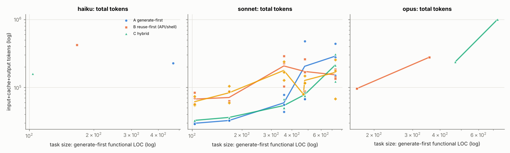
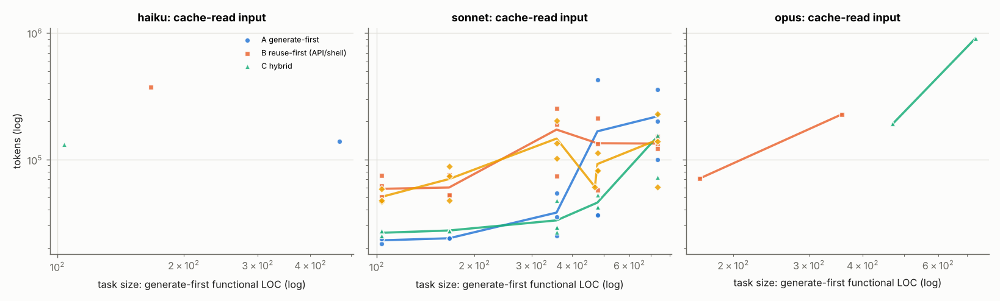
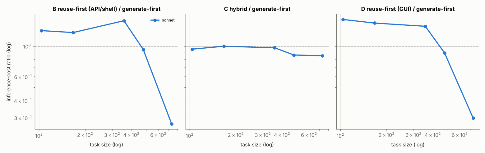

# Size-dependent retrieval economics across Claude models

_Generated by `bench/harness/report.py`. 72 runs; models `claude-haiku-5-5`, `claude-sonnet-5-5`, `claude-opus-5-5` at effort `medium`; agent harness Claude Code CLI headless. Raw data: `results/`._

### Design

| | |
|---|---|
| tasks | `calc-s1` (S1, calculator, ~104 LOC), `todo-s1` (S1, todo, ~167 LOC), `calc-s2` (S2, calculator, ~358 LOC), `markdown-s1` (S1, markdown, ~470 LOC), `kanban-s3` (S3, kanban, ~478 LOC), `markdown-s2` (S2, markdown, ~733 LOC), `pm-s4` (S4, kanban, ~nan LOC) |
| strategies | A generate-first, B reuse-first (API/shell), C hybrid, D reuse-first (GUI browser) |
| trials per cell | min 1, median 3, max 4 (29 cells) |
| measured inference spend | haiku $0.06, sonnet $10.79, opus $2.78; total **$13.63** |
| agent time | 1.6 h total |

## Summary of findings (pilot, n = 72 runs)

> **Scope.** One model (Claude Sonnet 5.5, effort medium) in one harness (Claude Code headless); six tasks in four size tiers, 4 strategies × 3 trials each. The tier targets were S1 100–300, S2 500–1k, S3 2–5k and S4 10–20k LOC. The **measured** generate-first sizes were only 104–167 (S1), 358–733 (S2), 478 (S3) and 1,163 (S4) functional LOC. The agent writes dense code (normalized size ≈ 1.6× raw LOC). The x-axis therefore spans about 100–1,200 LOC, and nothing here speaks to 10k+ LOC systems. S5 was specified but not run.

**Telemetry is exact.** In all 72 runs, the provider-reported per-message usage sums exactly to the harness aggregate in every token class. Computed cost matches the harness's own cost to ≤ $0.000001. (That check caught a stale cache-read price in the reference table: Sonnet 5.5 cache reads are $0.10/M, not $0.20/M.) Total measured spend: $18.09.

### Answers to the study questions

1. **At what size does reuse-first become cheaper?** There is no clean size-driven crossover in the observed range. The pooled log-log fit puts the ratio at 1 near ~300 LOC for weighted cost (B and D) and ~520–650 LOC for total tokens. That fit is driven almost entirely by one task family (markdown), so it is a **family** effect, not a size effect. Excluding markdown, reuse-first (B) costs **1.26–1.54×** generate-first at S1–S2 (CIs exclude 1). At S3–S4 it costs **0.95–0.97×**, with CIs [0.70–1.30] and [0.82–1.13] that include 1, and the final code contained 0–3% external lines there. The ratio approaches 1 with size because retrieval is a roughly **fixed overhead** (median $0.025 per run) that gets diluted. Reuse did not start paying for itself.
2. **Tokens vs dollars.** The crossovers differ. Reuse runs read far more (cached) input: 2.1–3.5× the total tokens at S1–S2 but only 1.3–1.5× the cost, because cache reads cost 0.05× the input price. With the cache, input-heavy retrieval is much cheaper in dollars than in raw tokens. The fitted token crossover (~520–650 LOC) sits about 2× above the dollar crossover (~300 LOC). Wall-clock is the noisiest metric (CIs up to 0.03–30× at S4, driven by occasional hung test commands) and has no usable crossover.
3. **Does computer use make retrieval uneconomical?** Not in total cost here. GUI (D) vs API/shell (B) total cost is 0.84–1.17× across tasks. GUI retrieval itself is cheap per action: about 2 screenshots per run, ~2.7k image tokens, and visual reasoning at about 31% of D's spend. But the GUI condition **acquired code less often** (28% of runs vs 50% for B). Its main channel was blocked: Stack Overflow serves a Cloudflare challenge (HTTP 403) to the headless browser, and the auto-mode permission classifier refused browser pastes as "Code from External" in all three GUI markdown runs (two worked around it). One markdown GUI run stopped with nothing built (pass rate 66% for D on markdown). GUI agents mostly searched once or twice and then generated.
4. **Is shell/API retrieval materially more efficient than GUI?** Per unit of code acquired, yes. B pulled whole packages (`npm-fetch`, clone) into a provenance-tracked cache and reached 48% external code on markdown in all three trials. D reached it only by pasting a raw file. Per run, total costs were similar, because both mostly ended up generating.
5. **Cloning vs snippets.** Cloning did not win. Runs that cloned cost 1.06× generate-first on average (20% external code). Runs that fetched single files or snippets, or copied via the GUI, cost 0.95× (39% external). Search-only runs cost 1.09×. The cheapest reuse runs (0.17–0.19×) vendored one prebuilt **minified distribution file** of markdown-it plus ~50–65 LOC of glue.
6. **Reading irrelevant code.** About **52%** of the cost of reading retrieval results (consumed-result attribution) went to material that contributed no line to the final code. That's an estimate: reading cost × discarded share. 31 of 36 reuse/GUI runs reused essentially nothing (<20% external), spending a median 15% of their budget on retrieval.
7. **How much integration code?** In the five successful reuse runs, the agent generated 50–226 functional LOC of glue (safe-mode URL filtering, slug/TOC, CLI) around 77–9,474 incorporated lines. Integration editing was negligible, at under 1% of cost.
8. **Categories with the greatest reuse potential.** Markdown: a standardized format (CommonMark/GFM) with mature, permissively licensed, dependency-free libraries whose output matches the spec. Reuse cut cost by **73%** (B: 0.27×, CI 0.16–0.45) and wall-clock by 72%. The other families had idiosyncratic APIs, a stdlib-only constraint, and existing projects built on frameworks or databases. Agents searched, found nothing that fit, and generated.
9. **Better implemented from scratch.** Calculators, todo lists, and the Kanban and project-management services at the sizes tested. For these the search was pure overhead (+26–54% at S1–S2).
10. **Is hybrid consistently better?** Hybrid never chose to retrieve: 0 searches in 18 runs. In practice it is generate-first with a one-line cost estimate, and its costs match A within noise (0.86–1.00×, all CIs include 1). It avoided the S1–S2 retrieval penalty. On markdown it missed the 73% saving that reuse-first found, so the agent's own reuse-vs-generate estimate is biased toward generation.
11. **Optimal retrieval budget.** All five successful reuses found their source within ≤3 search queries and ≤$0.085 of retrieval spend (median $0.036). Failed runs used up to 7 queries and $0.15. A practical stopping rule from this pilot: **abandon after ~3 queries (≈$0.04 at Sonnet 5.5 prices, ≈5% of a mid-size generate run) if no candidate covers most of the spec.** This is small-n and should be re-estimated with more families.

### Other observations

- **Debugging** was <1% of cost in every strategy, because most first implementations already passed. So this pilot cannot show whether retrieved code increases debugging.
- **Quality.** Pass rates were 100% for A, B and C, and 94% for D (the classifier-blocked run). There were no runtime dependencies or syntax errors. Pattern-based security findings were ~1.6–2.1 per run in all strategies, mostly `innerHTML` assignments in the generated SPAs.
- **License compliance.** It was weaker for reuse: 89% (B) and 72% (D) of runs were compliant, vs 100% for A and C. The failures were missing NOTICE files, missing license fields, and undeclared copied lines.
- **Advisory prompts don't produce reuse.** In protocol v0 (advisory wording, kept in `results/runs_protocol_v0/`) reuse agents skipped retrieval entirely at S1. Reuse behavior required a mandatory protocol. Without one, the model defaults to generation.
- **Harness confounds that bias against reuse.** These are the safety classifier's denials and Stack Overflow blocking automated browsers. The classifier denied actions in 4 runs: "Code from External" in all 3 GUI markdown runs, and in one of them the agent stopped with nothing built; one unrelated "Interfere With Workloads" denial in an S4 reuse run. The API/shell path to Stack Overflow (Stack Exchange API) worked.

## 1. Telemetry validation

| model | runs whose per-message usage sums exactly to the harness aggregate | unattributed tokens | max |computed − harness cost| |
|---|---|---|---|
| haiku | 3/3 | 0 | $0.000000 |
| sonnet | 65/65 | 0 | $0.000001 |
| opus | 4/4 | 0 | $0.000000 |

Every model invocation is one event in `results/events.jsonl` with provider-reported input, output, cache-read, cache-write (5m/1h) and thinking tokens. No token count is estimated; estimates are confined to named columns (`screenshot_tokens_estimate`, `compute_cost_usd_estimate`, `irrelevant_reading_cost_usd_est`).

## 2. Crossover estimates (regression with task fixed effects)

Model per LLM: `log(cost) ~ task + strategy + strategy × log(task size)` (OLS, HC3 standard errors). For each reuse strategy the fitted log-ratio to generate-first is `β + γ·(log size − mean)`; the crossover is the size where it reaches 0. 95% CIs from 200 bootstrap resamples of runs within each task×strategy cell. `γ < 0` means reuse becomes relatively cheaper as tasks grow.

### weighted inference cost (USD)

| families | model | vs A | runs | ratio at mean size (p) | size slope γ [95% CI] (p) | crossover LOC [95% CI] |
|---|---|---|---|---|---|---|
| all_families | ALL_MODELS | B reuse | 71 | 1.08 (p=0.723) | -0.49 [-0.73, -0.22] (p=0.076) | 337 [215–676] |
| all_families | ALL_MODELS | C hybrid | 71 | 1.09 (p=0.715) | +0.36 [+0.12, +0.68] (p=0.241) | 229 [94–363] |
| all_families | ALL_MODELS | D GUI | 71 | 1.05 (p=0.797) | -0.66 [-0.95, -0.39] (p=0.024) | 313 [259–438] |
| all_families | haiku | B reuse | 3 | 0.55 (p=0.486) | +0.11 [+0.11, +0.11] (p=0.486) | 43,522 [43,522–43,522] (outside observed range) |
| all_families | haiku | C hybrid | 3 | 0.25 (p=0.216) | +0.92 [+0.92, +0.92] (p=0.216) | 909 [909–909] (outside observed range) |
| all_families | opus | B reuse | 4 | 0.82 (p=0.563) | +0.37 [+0.37, +0.37] (p=0.383) | 652 [652–652] |
| all_families | opus | C hybrid | 4 | 1.00 (p=0.990) | +0.12 [+0.12, +0.12] (p=0.703) | 366 [366–366] |
| all_families | sonnet | B reuse | 64 | 0.91 (p=0.465) | -0.62 [-0.81, -0.41] (p=0.002) | 247 [214–318] |
| all_families | sonnet | C hybrid | 64 | 0.92 (p=0.446) | -0.07 [-0.21, +0.06] (p=0.691) | 85 (outside observed range) |
| all_families | sonnet | D GUI | 64 | 0.95 (p=0.729) | -0.75 [-1.10, -0.47] (p=0.003) | 270 [229–352] |
| excluding_markdown | ALL_MODELS | B reuse | 55 | 1.35 (p=0.075) | +0.01 [-0.25, +0.31] (p=0.959) | 0 (outside observed range) |
| excluding_markdown | ALL_MODELS | C hybrid | 55 | 0.86 (p=0.237) | +0.16 [-0.13, +0.51] (p=0.535) | 570 [1–6,310] (outside observed range) |
| excluding_markdown | ALL_MODELS | D GUI | 55 | 1.31 (p=0.001) | -0.27 [-0.48, -0.09] (p=0.086) | 625 [370–4,496] (outside observed range) |
| excluding_markdown | haiku | B reuse | 2 | 0.53 (p=0.632) | -0.15 [-0.15, -0.15] (p=0.632) | 2 [2–2] (outside observed range) |
| excluding_markdown | haiku | C hybrid | 2 | 0.14 (p=0.233) | +0.47 [+0.47, +0.47] (p=0.233) | 8,726 [8,726–8,726] (outside observed range) |
| excluding_markdown | sonnet | B reuse | 51 | 1.25 (p=0.004) | -0.09 [-0.25, +0.07] (p=0.477) | 2,444 (outside observed range) |
| excluding_markdown | sonnet | C hybrid | 51 | 0.95 (p=0.401) | -0.04 [-0.20, +0.08] (p=0.713) | 70 [2–362,980] (outside observed range) |
| excluding_markdown | sonnet | D GUI | 51 | 1.31 (p=0.001) | -0.27 [-0.47, -0.08] (p=0.073) | 625 [371–6,215] (outside observed range) |
| markdown_only | ALL_MODELS | B reuse | 16 | 0.25 (p=0.001) | -0.11 [-0.15, -0.08] (p=0.001) | 0 [0–0] (outside observed range) |
| markdown_only | ALL_MODELS | C hybrid | 16 | 1.93 (p=0.100) | -6.52 [-7.59, -5.31] (p=0.043) | 746 [699–828] (outside observed range) |
| markdown_only | ALL_MODELS | D GUI | 16 | 0.42 (p=0.128) | -6.02 [-8.23, -4.59] (p=0.097) | 583 [550–624] |
| markdown_only | sonnet | B reuse | 13 | 0.25 (p=0.001) | -0.05 [-0.06, -0.03] (p=0.001) | 0 [0–0] (outside observed range) |
| markdown_only | sonnet | C hybrid | 13 | 0.86 (p=0.512) | -0.01 [-0.02, +0.00] (p=0.512) | 0 [0–0] (outside observed range) |
| markdown_only | sonnet | D GUI | 13 | 0.25 (p=0.024) | +0.22 [-0.18, +0.59] (p=0.950) | 426,223 (outside observed range) |

### cache-independent cost (all input priced uncached)

| families | model | vs A | runs | ratio at mean size (p) | size slope γ [95% CI] (p) | crossover LOC [95% CI] |
|---|---|---|---|---|---|---|
| all_families | ALL_MODELS | B reuse | 12 | 22.07 (p=0.454) | +3.30 [-2.36, +6.16] (p=0.556) | 97 [0–21,393] (outside observed range) |
| all_families | ALL_MODELS | C hybrid | 12 | 4.81 (p=0.492) | +2.94 [+0.27, +3.65] (p=0.311) | 144 [0–182] |
| all_families | ALL_MODELS | D GUI | 12 | 3.22 (p=0.181) | +0.75 [+0.41, +0.83] (p=0.181) | 52 [8–63] (outside observed range) |
| all_families | haiku | B reuse | 3 | 0.73 (p=0.002) | +0.06 [+0.06, +0.06] (p=0.002) | 43,522 [43,522–43,522] (outside observed range) |
| all_families | haiku | C hybrid | 3 | 0.33 (p=0.000) | +0.74 [+0.74, +0.74] (p=0.000) | 909 [909–909] (outside observed range) |
| all_families | opus | B reuse | 4 | 1.05 (p=0.977) | +0.49 [+0.49, +0.49] (p=0.705) | 341 [341–341] |
| all_families | opus | C hybrid | 4 | 1.30 (p=0.703) | +0.36 [+0.36, +0.36] (p=0.238) | 182 [182–182] |
| all_families | sonnet | B reuse | 5 | 1.54 (p=1.000) | -0.28 [-0.29, +0.51] (p=1.000) | 931 [772–2,952] (outside observed range) |
| all_families | sonnet | C hybrid | 5 | 1.40 (p=1.000) | +0.21 [-0.14, +0.24] (p=1.000) | 38 (outside observed range) |
| all_families | sonnet | D GUI | 5 | 1.45 (p=1.000) | +0.32 [-0.19, +0.35] (p=1.000) | 62 [30–64] (outside observed range) |
| excluding_markdown | ALL_MODELS | B reuse | 8 | 2.06 (p=1.000) | +1.01 [-2.62, +2.38] (p=1.000) | 82 [0–126,970] (outside observed range) |
| excluding_markdown | ALL_MODELS | C hybrid | 8 | 0.52 (p=1.000) | +0.64 [-1.64, +2.98] (p=1.000) | 473 [0–183,105] |
| excluding_markdown | haiku | B reuse | 2 | 0.66 (p=0.667) | -0.10 [-0.10, -0.10] (p=0.667) | 2 [2–2] (outside observed range) |
| excluding_markdown | haiku | C hybrid | 2 | 0.18 (p=0.055) | +0.41 [+0.41, +0.41] (p=0.055) | 8,726 [8,726–8,726] (outside observed range) |
| excluding_markdown | sonnet | B reuse | 4 | 1.67 (p=1.000) | -0.22 [-0.27, +0.43] (p=1.000) | 1,638 [840–513,710] (outside observed range) |
| excluding_markdown | sonnet | C hybrid | 4 | 1.35 (p=1.000) | +0.25 [-0.21, +0.27] (p=1.000) | 48 (outside observed range) |
| markdown_only | ALL_MODELS | C hybrid | 4 | 32.48 (p=1.000) | +0.14 [-0.17, +0.14] (p=1.000) | 0 (outside observed range) |
| markdown_only | ALL_MODELS | D GUI | 4 | 5.13 (p=1.000) | -0.18 [-0.35, -0.18] (p=1.000) | 4,258,692 [52,852–4,258,692] (outside observed range) |

### total tokens incl. cache

| families | model | vs A | runs | ratio at mean size (p) | size slope γ [95% CI] (p) | crossover LOC [95% CI] |
|---|---|---|---|---|---|---|
| all_families | ALL_MODELS | B reuse | 71 | 1.82 (p=0.004) | -0.65 [-1.01, -0.34] (p=0.010) | 724 [424–3,375] |
| all_families | ALL_MODELS | C hybrid | 71 | 1.05 (p=0.820) | -0.27 [-0.74, +0.20] (p=0.404) | 346 [3–3,673] |
| all_families | ALL_MODELS | D GUI | 71 | 1.43 (p=0.070) | -0.71 [-0.99, -0.40] (p=0.005) | 481 [316–1,149] |
| all_families | haiku | B reuse | 3 | 9.02 (p=0.512) | -0.41 [-0.41, -0.41] (p=0.512) | 43,522 [43,522–43,522] (outside observed range) |
| all_families | haiku | C hybrid | 3 | 11.30 (p=0.019) | -1.61 [-1.61, -1.61] (p=0.019) | 909 [909–909] (outside observed range) |
| all_families | opus | B reuse | 4 | 114.15 (p=0.852) | +0.34 [+0.34, +0.34] (p=0.986) | 0 [0–0] (outside observed range) |
| all_families | opus | C hybrid | 4 | 21.70 (p=0.772) | +1.52 [+1.52, +1.52] (p=0.843) | 50 [50–50] (outside observed range) |
| all_families | sonnet | B reuse | 64 | 1.62 (p=0.014) | -0.56 [-0.85, -0.27] (p=0.012) | 679 [358–4,381] |
| all_families | sonnet | C hybrid | 64 | 0.87 (p=0.422) | -0.28 [-0.61, +0.01] (p=0.236) | 173 [86–1,458] |
| all_families | sonnet | D GUI | 64 | 1.54 (p=0.030) | -0.64 [-1.04, -0.22] (p=0.015) | 566 [320–6,796] |
| excluding_markdown | ALL_MODELS | B reuse | 55 | 2.46 (p=0.000) | -0.23 [-0.79, +0.21] (p=0.591) | 11,683 (outside observed range) |
| excluding_markdown | ALL_MODELS | C hybrid | 55 | 1.01 (p=0.962) | -0.59 [-1.26, -0.04] (p=0.181) | 230 [156–1,377] |
| excluding_markdown | ALL_MODELS | D GUI | 55 | 1.98 (p=0.001) | -0.30 [-0.85, +0.15] (p=0.435) | 2,139 (outside observed range) |
| excluding_markdown | haiku | B reuse | 2 | 16.04 (p=0.265) | +0.66 [+0.66, +0.66] (p=0.265) | 2 [2–2] (outside observed range) |
| excluding_markdown | haiku | C hybrid | 2 | 87.32 (p=0.000) | -1.07 [-1.07, -1.07] (p=0.000) | 8,726 [8,726–8,726] (outside observed range) |
| excluding_markdown | sonnet | B reuse | 51 | 2.10 (p=0.001) | -0.19 [-0.74, +0.34] (p=0.653) | 12,242 (outside observed range) |
| excluding_markdown | sonnet | C hybrid | 51 | 0.91 (p=0.605) | -0.36 [-0.96, +0.03] (p=0.318) | 176 [0–9,098] |
| excluding_markdown | sonnet | D GUI | 51 | 1.97 (p=0.001) | -0.30 [-0.83, +0.12] (p=0.436) | 2,139 (outside observed range) |
| markdown_only | ALL_MODELS | B reuse | 16 | 0.58 (p=0.169) | -0.05 [-0.10, -0.01] (p=0.169) | 0 [0–0] (outside observed range) |
| markdown_only | ALL_MODELS | C hybrid | 16 | 1.12 (p=0.934) | +0.19 [-1.81, +2.05] (p=0.990) | 373 [211–677] (outside observed range) |
| markdown_only | ALL_MODELS | D GUI | 16 | 0.51 (p=0.384) | +1.04 [-1.02, +2.84] (p=0.888) | 1,301 (outside observed range) |
| markdown_only | sonnet | B reuse | 13 | 0.58 (p=0.169) | -0.02 [-0.03, -0.00] (p=0.169) | 0 [0–0] (outside observed range) |
| markdown_only | sonnet | C hybrid | 13 | 0.76 (p=0.588) | -0.01 [-0.04, +0.01] (p=0.588) | 0 [0–0] (outside observed range) |
| markdown_only | sonnet | D GUI | 13 | 0.62 (p=0.517) | -3.60 [-4.07, -3.19] (p=0.762) | 621 [518–782] |

## 3. Results by model, task and strategy

Ratios are mean(strategy)/mean(generate-first) on the same task and model, with bootstrap 95% CI; `*` = Welch test on log cost significant after Holm correction across all cells (α = 0.05). Bold = ratio < 1.

### haiku

| tier | task | strategy | n | pass rate | success [95% CI] | func. LOC | inference $ | $ ratio vs A | token ratio vs A | wall-clock ratio vs A | external code | elapsed min |
|---|---|---|---|---|---|---|---|---|---|---|---|---|
| S1 | calc-s1 | C hybrid | 1 | 100% | 100% [21%–100%] | 181 | 0.009 |  |  |  | 0% | 0.8 |
| S1 | markdown-s1 | A gen | 1 | 100% | 100% [21%–100%] | 470 | 0.032 |  |  |  | 0% | 3.2 |
| S1 | todo-s1 | B reuse | 1 | 100% | 100% [21%–100%] | 322 | 0.019 |  |  |  | 1% | 1.8 |

### sonnet

| tier | task | strategy | n | pass rate | success [95% CI] | func. LOC | inference $ | $ ratio vs A | token ratio vs A | wall-clock ratio vs A | external code | elapsed min |
|---|---|---|---|---|---|---|---|---|---|---|---|---|
| S1 | calc-s1 | A gen | 3 | 100% | 100% [44%–100%] | 104 | 0.043 |  |  |  | 0% | 0.3 |
| S1 | calc-s1 | D GUI | 3 | 100% | 100% [44%–100%] | 100 | 0.067 | 1.57 [1.20–2.10] | 2.08 [1.83–2.45] | 1.78 [1.55–2.08] | 0% | 0.6 |
| S1 | calc-s1 | C hybrid | 3 | 100% | 100% [44%–100%] | 93 | 0.041 | **0.95 [0.80–1.15]** | 1.10 [1.06–1.13] | 1.09 [0.84–1.40] | 0% | 0.4 |
| S1 | calc-s1 | B reuse | 4 | 100% | 100% [51%–100%] | 101 | 0.055 | 1.30 [1.18–1.46] | 2.27 [1.95–2.65] * | 1.44 [1.23–1.70] | 1% | 0.5 |
| S1 | markdown-s1 | D GUI | 1 | 100% | 100% [21%–100%] | 199 | 0.116 |  |  |  | 0% | 0.8 |
| S1 | todo-s1 | A gen | 3 | 100% | 100% [44%–100%] | 167 | 0.058 |  |  |  | 0% | 0.4 |
| S1 | todo-s1 | D GUI | 3 | 100% | 100% [44%–100%] | 164 | 0.085 | 1.48 [1.32–1.70] | 2.56 [1.82–3.19] | 1.61 [1.38–1.89] | 0% | 0.7 |
| S1 | todo-s1 | C hybrid | 4 | 100% | 100% [51%–100%] | 154 | 0.058 | 1.00 [0.97–1.04] | 1.11 [1.10–1.12] * | **0.95 [0.83–1.12]** | 0% | 0.4 |
| S1 | todo-s1 | B reuse | 3 | 100% | 100% [44%–100%] | 159 | 0.073 | 1.26 [1.17–1.38] | 2.18 [1.90–2.70] | 1.49 [1.20–1.83] | 1% | 0.7 |
| S2 | calc-s2 | A gen | 3 | 99% | 100% [44%–100%] | 358 | 0.142 |  |  |  | 0% | 1.1 |
| S2 | calc-s2 | D GUI | 3 | 100% | 100% [44%–100%] | 317 | 0.199 | 1.40 [1.17–1.67] | 3.00 [1.99–4.49] | 1.48 [1.25–1.76] | 5% | 1.6 |
| S2 | calc-s2 | C hybrid | 4 | 100% | 100% [51%–100%] | 333 | 0.139 | **0.97 [0.86–1.09]** | **0.91 [0.70–1.23]** | **0.95 [0.83–1.10]** | 0% | 1.0 |
| S2 | calc-s2 | B reuse | 3 | 99% | 100% [44%–100%] | 348 | 0.219 | 1.54 [1.27–1.85] | 3.49 [1.86–5.61] | 2.84 [1.42–4.13] | 12% | 3.0 |
| S2 | markdown-s2 | A gen | 3 | 100% | 100% [44%–100%] | 733 | 0.474 |  |  |  | 0% | 4.4 |
| S2 | markdown-s2 | D GUI | 3 | 66% | 67% [21%–94%] | 831 | 0.142 | **0.30 [0.10–0.48]** | **0.58 [0.24–1.19]** | **0.32 [0.15–0.60]** | 48% | 1.4 |
| S2 | markdown-s2 | C hybrid | 3 | 100% | 100% [44%–100%] | 601 | 0.404 | **0.85 [0.64–1.18]** | **0.74 [0.39–1.44]** | **0.58 [0.02–1.25]** | 0% | 2.6 |
| S2 | markdown-s2 | B reuse | 3 | 100% | 100% [44%–100%] | 3281 | 0.128 | **0.27 [0.16–0.44]** | **0.53 [0.35–1.00]** | **0.28 [0.18–0.47]** | 48% | 1.2 |
| S3 | kanban-s3 | A gen | 3 | 100% | 100% [44%–100%] | 478 | 0.254 |  |  |  | 0% | 1.0 |
| S3 | kanban-s3 | D GUI | 3 | 100% | 100% [44%–100%] | 383 | 0.227 | **0.89 [0.67–1.09]** | **0.62 [0.26–2.03]** | 4.76 [1.11–18.21] | 0% | 5.0 |
| S3 | kanban-s3 | C hybrid | 3 | 100% | 100% [44%–100%] | 474 | 0.219 | **0.86 [0.64–1.07]** | **0.38 [0.16–1.21]** | 1.42 [1.00–5.33] | 0% | 1.5 |
| S3 | kanban-s3 | B reuse | 3 | 100% | 100% [44%–100%] | 403 | 0.241 | **0.95 [0.70–1.30]** | **0.84 [0.33–3.40]** | 1.00 [0.35–3.61] | 0% | 1.0 |
| S4 | pm-s4 | B reuse | 1 | 100% | 100% [21%–100%] | 1055 | 0.623 |  |  |  | 2% | 4.1 |

### opus

| tier | task | strategy | n | pass rate | success [95% CI] | func. LOC | inference $ | $ ratio vs A | token ratio vs A | wall-clock ratio vs A | external code | elapsed min |
|---|---|---|---|---|---|---|---|---|---|---|---|---|
| S1 | markdown-s1 | C hybrid | 1 | 100% | 100% [21%–100%] | 668 | 0.644 |  |  |  | 0% | 2.9 |
| S1 | todo-s1 | B reuse | 1 | 100% | 100% [21%–100%] | 225 | 0.306 |  |  |  | 9% | 1.5 |
| S2 | calc-s2 | B reuse | 1 | 100% | 100% [21%–100%] | 551 | 0.655 |  |  |  | 12% | 2.8 |
| S2 | markdown-s2 | C hybrid | 1 | 100% | 100% [21%–100%] | 2759 | 1.178 |  |  |  | 91% | 4.8 |

## 4. Model comparison

| model | strategy | runs | success | mean $ | $ per success | mean LOC | output tok | cache-read share of input | acquired code | external code |
|---|---|---|---|---|---|---|---|---|---|---|
| haiku | A gen | 1 | 100% | 0.032 | 0.032 | 470 | 42.5k | 75% | 0% | 0% |
| haiku | B reuse | 1 | 100% | 0.019 | 0.019 | 322 | 20.4k | 93% | 100% | 1% |
| haiku | C hybrid | 1 | 100% | 0.009 | 0.009 | 181 | 8.9k | 89% | 0% | 0% |
| sonnet | A gen | 15 | 100% | 0.194 | 0.194 | 368 | 12.1k | 80% | 0% | 0% |
| sonnet | B reuse | 17 | 100% | 0.166 | 0.166 | 826 | 9.3k | 88% | 47% | 11% |
| sonnet | C hybrid | 17 | 100% | 0.163 | 0.163 | 321 | 10.0k | 79% | 0% | 0% |
| sonnet | D GUI | 16 | 94% | 0.142 | 0.152 | 349 | 7.5k | 87% | 31% | 10% |
| opus | B reuse | 2 | 100% | 0.481 | 0.481 | 388 | 12.9k | 84% | 50% | 11% |
| opus | C hybrid | 2 | 100% | 0.911 | 0.911 | 1714 | 23.1k | 91% | 50% | 45% |

Geometric-mean inference-cost ratio vs generate-first, by tier:

| model | strategy | S1 | S2 | S3 |
|---|---|---|---|---|
| sonnet | D GUI | 1.53 | **0.65** | **0.89** |
| sonnet | C hybrid | **0.98** | **0.91** | **0.86** |
| sonnet | B reuse | 1.28 | **0.64** | **0.95** |

## 5. Where the money goes (cost share by emitted action)

| model | strategy | tier | retrieval | gui | copy/integration | code writing | testing/debugging | planning/other |
|---|---|---|---|---|---|---|---|---|
| haiku | A gen | S1 |  |  |  | 68% |  | 32% |
| haiku | C hybrid | S1 |  |  |  | 37% | 15% | 47% |
| haiku | B reuse | S1 | 8% |  |  | 64% | 6% | 22% |
| opus | C hybrid | S1 |  |  |  | 77% |  | 23% |
| opus | C hybrid | S2 | 14% |  | 2% | 24% |  | 60% |
| opus | B reuse | S1 | 19% |  |  | 47% |  | 34% |
| opus | B reuse | S2 | 12% |  |  | 65% | 13% | 10% |
| sonnet | A gen | S1 |  |  |  | 60% |  | 40% |
| sonnet | A gen | S2 |  |  |  | 72% | 11% | 18% |
| sonnet | A gen | S3 |  |  |  | 63% | 7% | 30% |
| sonnet | D GUI | S1 |  | 16% |  | 51% |  | 34% |
| sonnet | D GUI | S2 |  | 18% | 6% | 50% | 5% | 20% |
| sonnet | D GUI | S3 |  | 15% |  | 65% |  | 20% |
| sonnet | C hybrid | S1 |  |  |  | 59% |  | 41% |
| sonnet | C hybrid | S2 |  |  |  | 65% | 5% | 30% |
| sonnet | C hybrid | S3 |  |  |  | 62% |  | 38% |
| sonnet | B reuse | S1 | 25% |  |  | 39% |  | 36% |
| sonnet | B reuse | S2 | 23% |  | 1% | 52% | 12% | 13% |
| sonnet | B reuse | S3 | 10% |  |  | 56% | 9% | 25% |
| sonnet | B reuse | S4 | 5% |  |  | 89% |  | 6% |

_`results/cost_by_action.csv` has the full action breakdown and the consumed-result attribution._

## 6. Retrieval efficiency

| model | strategy | runs | queries | repos inspected | clones | snippets | retrieved LOC | incorporated | generated LOC | external code | runs with >20% reuse | search→use | retrieval fail | retrieval cost share | reading cost on unused material (est.) |
|---|---|---|---|---|---|---|---|---|---|---|---|---|---|---|---|
| haiku | C hybrid | 1 | 0.0 | 0.0 | 0.0 | 0.0 | 0 | 0 | 181 | 0% | 0% | – | 0% | 0% | – |
| haiku | B reuse | 1 | 6.0 | 1.0 | 1.0 | 0.0 | 3,683 | 3 | 318 | 1% | 0% | 7% | 40% | 8% | 100% |
| opus | C hybrid | 2 | 0.0 | 0.0 | 1.0 | 1.0 | 10,612 | 1,225 | 462 | 45% | 50% | 65% | 0% | 8% | 88% |
| opus | B reuse | 2 | 4.5 | 0.5 | 1.0 | 0.5 | 2,720 | 22 | 344 | 11% | 0% | 41% | 25% | 15% | 98% |
| sonnet | D GUI | 16 | 1.3 | 0.3 | 0.0 | 0.2 | 202 | 144 | 202 | 10% | 12% | 100% | 5% | 21% | 17% |
| sonnet | C hybrid | 17 | 0.0 | 0.0 | 0.0 | 0.0 | 0 | 0 | 321 | 0% | 0% | – | 0% | 0% | – |
| sonnet | B reuse | 17 | 3.5 | 0.2 | 0.5 | 0.1 | 2,857 | 560 | 257 | 11% | 18% | 24% | 39% | 22% | 90% |

Clone vs snippet acquisition (all reuse runs, inference-cost ratio vs generate-first on the same model and task):

| acquisition mode | runs | geo-mean $ ratio vs A | external code | success |
|---|---|---|---|---|
| clone / package fetch | 13 | 0.80 | 23% | 100% |
| file / snippet / GUI copy | 5 | 0.78 | 32% | 100% |
| no retrieval | 19 | 0.93 | 0% | 100% |
| searched, acquired nothing | 19 | 1.03 | 0% | 95% |

## 7. GUI (browser) retrieval vs API/shell retrieval

| model | task | D/B total $ | D/B retrieval $ | B reused | D reused | D screenshots | D failed nav | D visual-reasoning $ |
|---|---|---|---|---|---|---|---|---|
| sonnet | calc-s1 | 1.21 | 0.59 | 0% | 0% | 1.0 | 0.0 | 0.025 |
| sonnet | todo-s1 | 1.17 | 1.26 | 0% | 0% | 1.3 | 0.0 | 0.022 |
| sonnet | calc-s2 | 0.91 | 1.79 | 0% | 0% | 3.0 | 0.0 | 0.055 |
| sonnet | kanban-s3 | 0.94 | 1.38 | 0% | 0% | 2.0 | 0.0 | 0.139 |
| sonnet | markdown-s2 | 1.11 | 0.61 | 100% | 67% | 1.7 | 0.7 | 0.011 |

## 8. Quality, security, licensing, protocol compliance

| model | strategy | runs | pass rate | success | 100% pass | security findings/run | runtime deps | license-compliant | syntax errors | dup. lines | protocol compliant | acquired code | permission denials | contamination flags | non-success exits |
|---|---|---|---|---|---|---|---|---|---|---|---|---|---|---|---|
| haiku | A gen | 1 | 100% | 100% | 100% | 0.00 | 0 | 100% | 0 | 6.4% | 100% | 0% | 0 | 0 | 0 |
| haiku | B reuse | 1 | 100% | 100% | 100% | 0.00 | 0 | 100% | 0 | 6.0% | 100% | 100% | 0 | 0 | 0 |
| haiku | C hybrid | 1 | 100% | 100% | 100% | 0.00 | 0 | 100% | 0 | 5.7% | 100% | 0% | 0 | 0 | 0 |
| sonnet | A gen | 15 | 100% | 100% | 93% | 0.80 | 0 | 100% | 0 | 5.0% | 100% | 0% | 0 | 0 | 0 |
| sonnet | B reuse | 17 | 100% | 100% | 94% | 1.18 | 0 | 88% | 0 | 4.9% | 100% | 47% | 0 | 0 | 0 |
| sonnet | C hybrid | 17 | 100% | 100% | 100% | 0.65 | 0 | 100% | 0 | 4.4% | 100% | 0% | 0 | 0 | 0 |
| sonnet | D GUI | 16 | 94% | 94% | 88% | 0.38 | 0 | 75% | 0 | 4.5% | 100% | 31% | 4 | 0 | 0 |
| opus | B reuse | 2 | 100% | 100% | 100% | 0.00 | 0 | 100% | 0 | 5.1% | 100% | 50% | 0 | 0 | 0 |
| opus | C hybrid | 2 | 100% | 100% | 100% | 0.00 | 0 | 100% | 0 | 11.4% | 100% | 50% | 0 | 0 | 0 |

_Security findings are pattern-based (eval/Function, exec with interpolation, innerHTML assignment, weak password hashing, Math.random tokens, hard-coded secrets, path traversal)._

## 9. Plots


_Weighted inference cost vs task size, per model._



_Total tokens vs task size._


_Output tokens vs task size._


_Fresh input tokens vs task size._



_Cache-read tokens vs task size._



_Cost ratio vs generate-first by model._


_Output-token savings vs input-token overhead._


_Integration/copy cost vs retrieved LOC._


_GUI vs API/shell reuse, per model._


_Hidden-suite pass rate by tier and model._

## 10. Reproduction

```bash
cd bench
python3 run_experiment.py --tasks calc-s1,todo-s1,markdown-s1,calc-s2,markdown-s2,kanban-s3,markdown-s3,pm-s4,diagram-s5 \
  --models claude-haiku-5-5,claude-sonnet-5-5,claude-opus-5-5 --trials 5 --parallel 8
python3 -m harness.analyze && python3 -m harness.report
```
